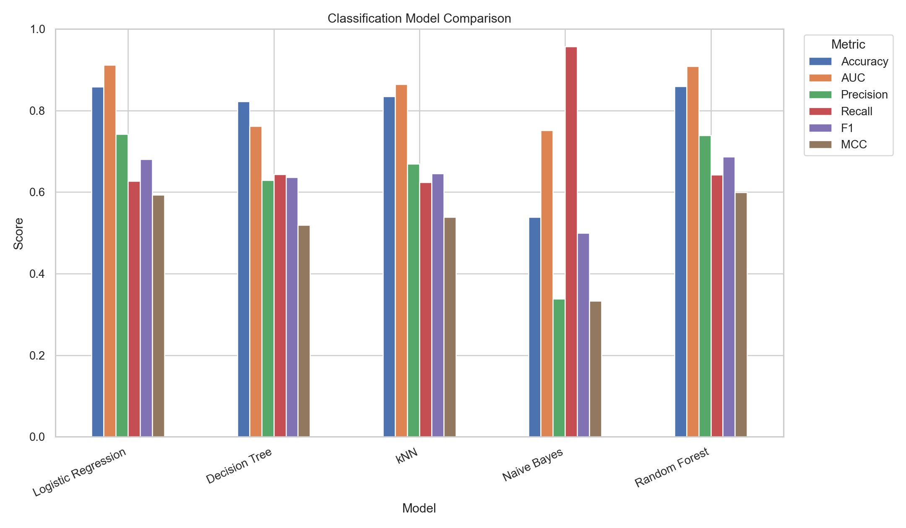

# ML Assignment 2 - Adult Income Classification

## Problem statement

Predict whether a person's annual income exceeds $50K using the UCI Adult Income dataset. This is a binary classification problem.

## Dataset description

- **Source:** UCI Machine Learning Repository, Adult Data Set
- **URL:** https://archive.ics.uci.edu/dataset/2/adult
- **Selected file:** UCI `adult.data` training file
- **Target variable:** `income`
- **Classes:** `<=50K` and `>50K`
- **Raw size:** 32,561 records
- **Usable size after duplicate removal:** 32,537 records
- **Features:** 14 input features
- **Feature types:** 6 numeric features and 8 categorical features
- **Missing values:** Represented by `?` in categorical columns and handled by most-frequent imputation

This dataset was selected because it is a public UCI dataset with more than 12 features and 1,000 instances, a binary income target, mixed numeric and categorical predictors, missing values, and class imbalance. It therefore supports the assignment's preprocessing and classification requirements.

After duplicate removal, 24,698 records (75.91%) have income `<=50K`, while 7,839 records (24.09%) have income `>50K`.

## Github Repository Link

**Repository URL:** _Add the GitHub URL after configuring the repository remote and publishing it._

## Data preprocessing

1. Replaced missing-value markers and removed exact duplicate records.
2. Encoded the target as `<=50K = 0` and `>50K = 1`.
3. Used median imputation and standard scaling for numeric features.
4. Used most-frequent imputation and one-hot encoding for categorical features.
5. Applied an 80:20 stratified train-test split with random seed `42`.
6. Fitted all preprocessing steps only on the training partition through scikit-learn pipelines.

## Models used

All precision, recall, and F1 values use `>50K` as the positive class. AUC is computed from predicted positive-class probabilities.

| ML Model Name | Accuracy | AUC | Precision | Recall | F1 | MCC |
|---|---:|---:|---:|---:|---:|---:|
| Logistic Regression | 0.8579 | 0.9115 | 0.7426 | 0.6276 | 0.6803 | 0.5932 |
| Decision Tree | 0.8228 | 0.7616 | 0.6294 | 0.6435 | 0.6364 | 0.5194 |
| kNN | 0.8350 | 0.8641 | 0.6689 | 0.6237 | 0.6455 | 0.5387 |
| Naive Bayes | 0.5393 | 0.7512 | 0.3386 | 0.9566 | 0.5002 | 0.3335 |
| Random Forest | 0.8591 | 0.9087 | 0.7388 | 0.6422 | 0.6871 | 0.5992 |



The five models use these configurations: Logistic Regression (`max_iter=1000`), Decision Tree (scikit-learn defaults), kNN (`n_neighbors=5`), Gaussian Naive Bayes (scikit-learn defaults), and Random Forest (`n_estimators=200`). All models use random seed `42` wherever the estimator supports it.

## Observations

- Random Forest has the best Accuracy (0.8591), F1 (0.6871), and MCC (0.5992).
- Logistic Regression has the highest AUC (0.9115), slightly ahead of Random Forest.
- Naive Bayes has the lowest overall accuracy but the highest recall (0.9566), because it predicts the positive class very frequently.
- Decision Tree has the lowest AUC and is more sensitive to overfitting than the ensemble model.
- kNN performs reasonably but is weaker than Logistic Regression and Random Forest across most metrics.
- Weighted or class-aware evaluation is important for this imbalanced dataset; accuracy alone is not sufficient.

## Execution instructions

```bash
cd ML_Assignment_2
python -m pip install -r requirements.txt
python model/classification_assignment.py
```

The script downloads the dataset, performs preprocessing and the stratified split, trains all five models, and writes:

- `test_data.csv`
- `model_results.csv`
- `model_results.json`
- `model_comparison.png`

Open `2026CT05040_ML_Assignment_2.ipynb` in Jupyter or VS Code to review the implementation interactively.

## Required BITS Virtual Lab screenshot

The final PDF must include a screenshot captured from the BITS Virtual Lab during execution. Add the genuine screenshot before submission; it is not included in this repository yet.
